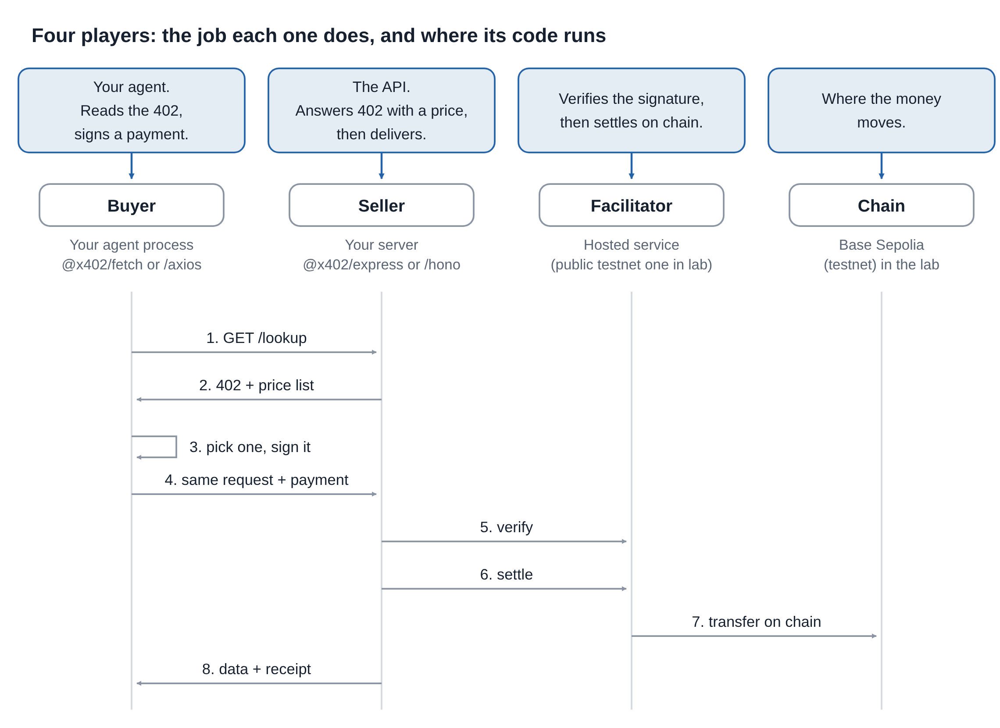
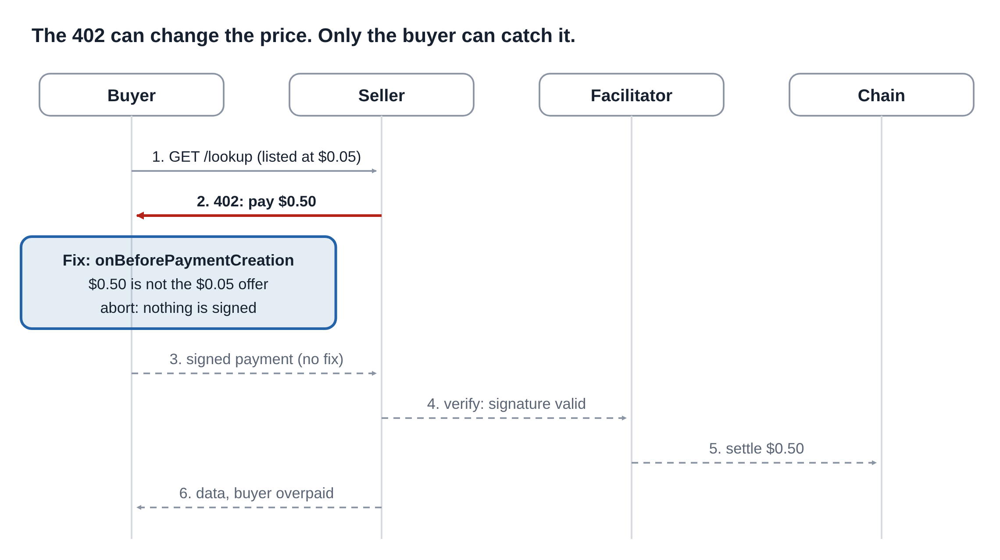
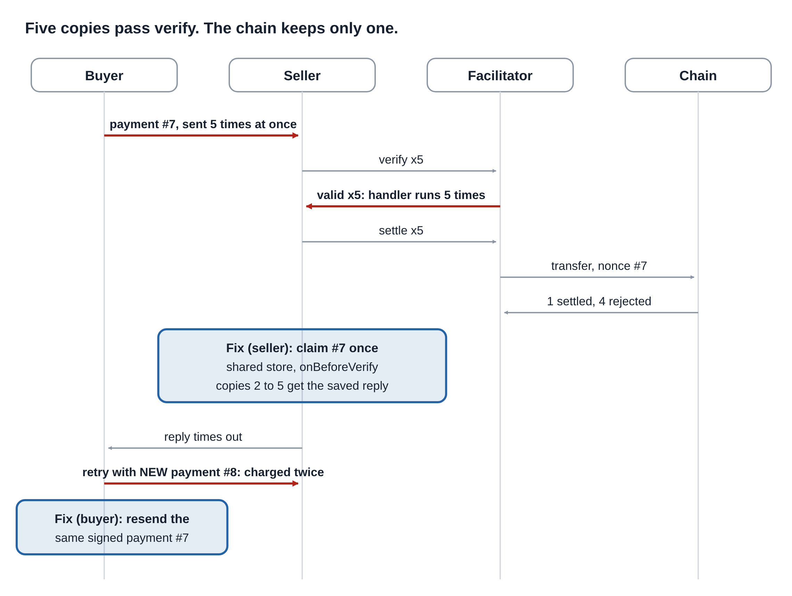
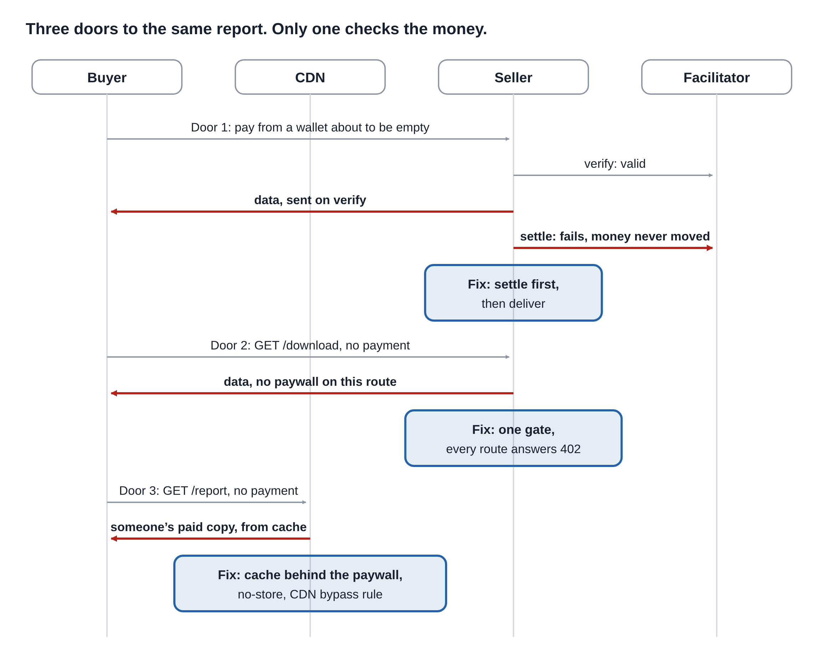
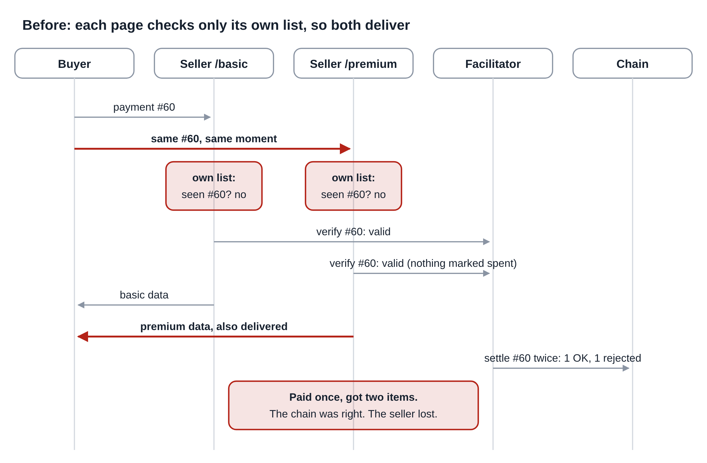
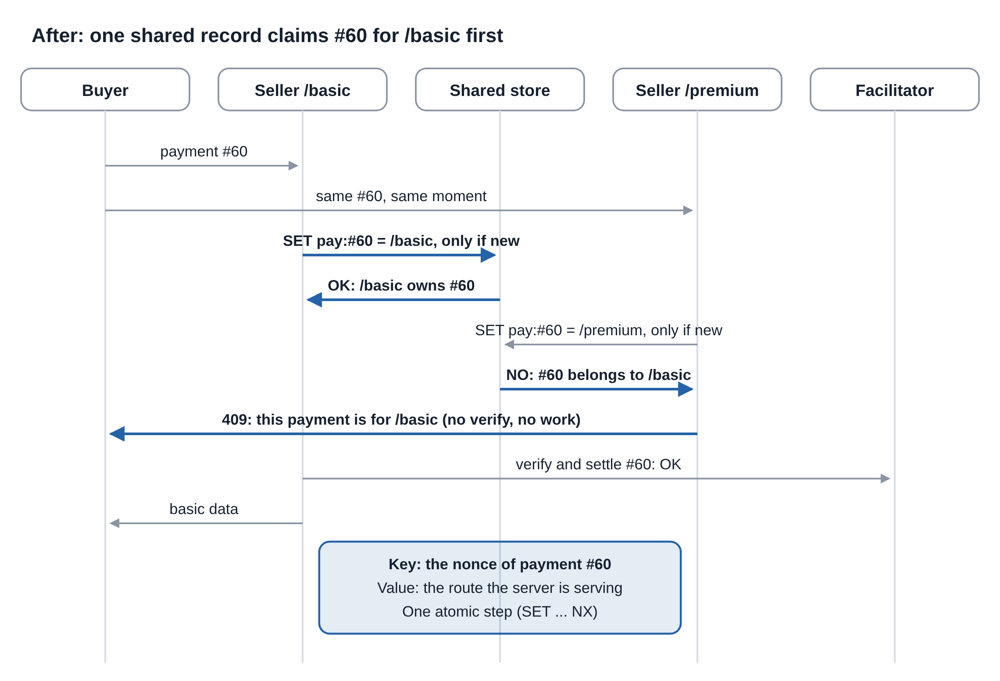
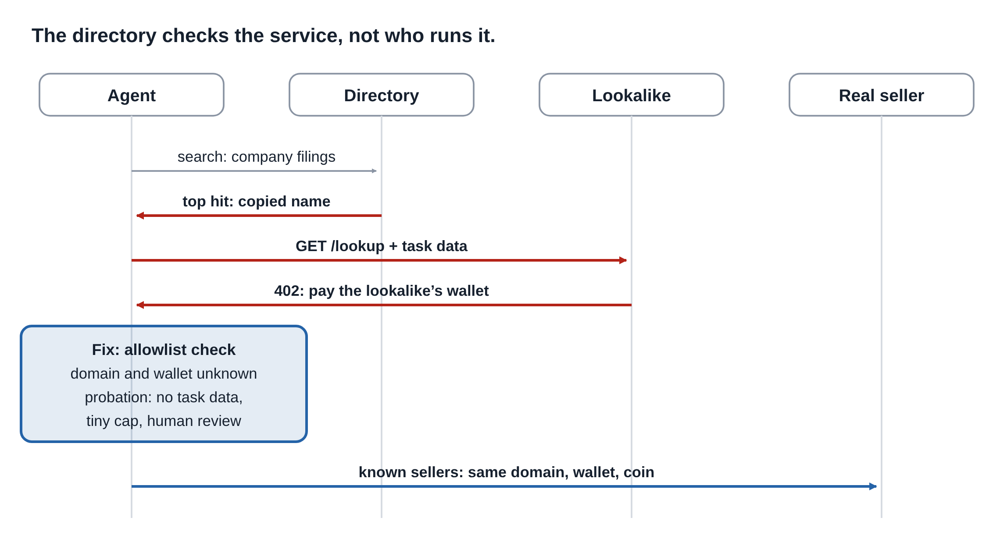
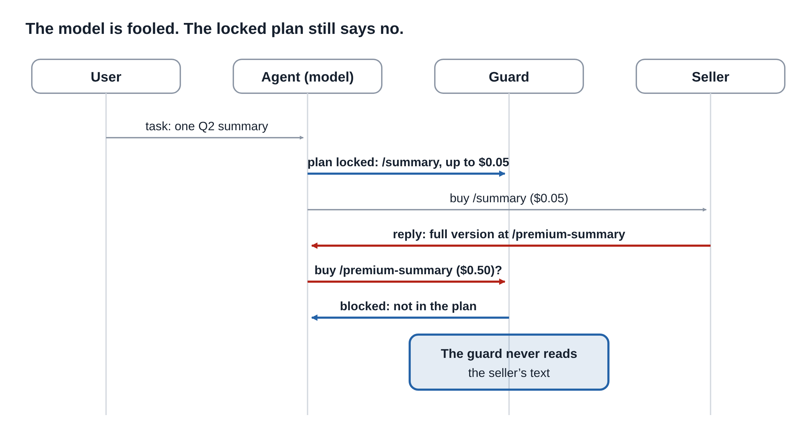

# x402 Attack Handbook

**Six attacks on autonomous agent payments, and where the fix lives.**

> Built for the official x402 TypeScript SDK (`@x402/*` 2.28.0), October 2026.
> A personal exploration, not an official project. Two attacks run live on a public
> testnet (Base Sepolia); the rest run in a local simulation that follows the same
> payment rules. Every claim below says where it was tested.

Agents can now discover paid APIs and pay for them over plain HTTP, with no human in
the loop. x402 makes this work. But a payment that settles correctly is not the same
as a payment that should have happened. This handbook shows six ways an agent payment
goes wrong, and the deterministic checks that stop each one, with no extra model call
in the authorization path.

---

## The four players

| Player | Job | Where its code runs |
| --- | --- | --- |
| Buyer | Your agent. Reads the 402, signs a payment. | Your agent process (`@x402/fetch`) |
| Seller | The API. Answers 402 with a price, then delivers. | Your server (`@x402/express`) |
| Facilitator | Verifies the signature, then settles on chain. | A hosted service (public testnet one in the lab) |
| Chain | Where the money moves. | Base Sepolia (testnet) in the lab |

**The happy path:** the buyer asks, the seller answers `402` with a price, the buyer
signs a payment, the facilitator **verifies** (signature, balance, unused nonce) and
then **settles** (moves the money), and the seller delivers. Verify and settle are
separate steps. Several attacks live in the gap between them.

**The one lesson:** none of the six fixes lives in the facilitator. It checks that a
payment is valid. It cannot know what your agent *meant* to buy, or what your seller
*meant* to deliver.

---

## How evidence is labeled

| Label | Meaning |
| --- | --- |
| **Testnet** | Ran live on Base Sepolia with the official SDK and the public facilitator |
| **Local sim** | Ran in the local simulation (`SimChain`), which follows EIP-3009 rules |
| **Docs** | Backed by the official x402 documentation |

The two live demos are cards 1 and 6. Cards 2 to 5 are tested in the local simulation;
testnet verification is in progress. See [RUNNING.md](RUNNING.md) for how to run each
one yourself, on a testnet or the local simulation, without risking real funds.

---

## Card 1: Price manipulation

**The attack:** the seller lists five cents, then asks for fifty cents in the 402, and
a vanilla buyer signs it. Changing the wallet (`payTo`) or the coin (`asset`) works the
same way.

**Who loses:** the buyer. **Where the fix lives:** the buyer, in `onBeforePaymentCreation`.

The agent chose an offer from a directory. The real price arrives later, inside the 402.
Nothing ties the two together, and the facilitator checks only the signature. The SDK's
default `$1` cap stops a `$5` typo, not fifty cents, and it does not cover `payTo`.

**The fix:** before signing, match every field of the 402 against the offer the agent
chose: amount, `payTo`, `asset`, network. If any differs, abort. No signature means
nothing reaches the facilitator or the chain.

- Attack and fix: [`src/cards/card1-price.ts`](src/cards/card1-price.ts)
- The guard: [`src/buyer/guard.ts`](src/buyer/guard.ts)
- Live on testnet: [`src/testnet/card1.ts`](src/testnet/card1.ts)

**Result:** Testnet, live, official SDK. Local sim benchmark: no guard overcharged in
most rounds; a price-only guard missed the `payTo` and `asset` cases; every-field guard
blocked all.

---

## Card 2: Duplicate payment

**The attack:** one signed payment, sent five times at once, can produce five
deliveries. And from the other side: one timeout makes the buyer pay twice.

**Who loses:** 2a the seller, 2b the buyer. **Where the fix lives:** the seller (claim
each payment once) and the buyer (retry with the same payment).

Each payment carries a one-time number (the EIP-3009 nonce), so the chain never moves
the same money twice. But verify only checks that the payment looks right, and the
nonce is not used until settle. Five copies can all pass verify. A seller that does
work before settle does it five times.

> **With the vanilla `@x402/express`:** the reply body is held until settle, so losing
> copies get a 402, not the data. But your route handler still ran per copy, so any side
> effect (an email, a paid API call, a database write) happened per copy.

**The fix (seller):** claim each payment once, in a shared store, keyed by the nonce,
before any work. The `payment-identifier` extension gives you the id and the docs tell
you to cache the answer by it; you bring the store (Redis). **The fix (buyer):** save
the signed payment and resend the same one on a timeout, never a fresh one.

- Attack and fix: [`src/cards/card2-replay.ts`](src/cards/card2-replay.ts)
- The seller: [`src/seller/seller.ts`](src/seller/seller.ts)

**Result:** Local sim. Testnet verification in progress. The seller "claim once" guidance
is also in the x402 facilitator docs (for Solana, a merchant settling without a
facilitator "must implement equivalent duplicate detection yourself").

---

## Card 3: Free shopping

**The attack:** the buyer gets paid data without the money ever moving, through one of
three doors.

**Who loses:** the seller. **Where the fix lives:** the seller and its infrastructure.

1. **Valid is not paid.** Verify is a snapshot: it checks the signature and the balance,
   but it does not hold the money. If the seller delivers on "valid," the money can be
   gone by settle. (The official facilitator checks the balance at verify, so an empty
   wallet fails there; the risk is a seller that delivers before settle completes, or a
   facilitator that checks signatures alone.)
2. **The side entrance.** The paywall guards `/report`, but the same data sits at
   `/download` with no paywall.
3. **The shared cache.** A buyer pays, the CDN keeps a copy, and the next person gets it
   free. The cache key is the URL, so it cannot tell paid from unpaid.

**The fix:** settle before you deliver; gate every route and test it; keep paid replies
out of shared caches (`no-store`, plus a CDN rule that skips paid routes). One rule
covers all three doors: nothing goes out unless a payment came in.

- Attack and fix: [`src/cards/card3-free-shopping.ts`](src/cards/card3-free-shopping.ts)
- The cache stand-in: [`src/seller/cache.ts`](src/seller/cache.ts)

**Result:** Local sim. Door 1 shown with a signature-only facilitator; with a strict
facilitator the empty-wallet case fails at verify, as expected.

---

## Card 4: Right payment, wrong item

Before: the fix for card 2, if it checks only the payment id, opens this door.

After: bind each payment to the one item it paid for.

**The attack:** card 2's fix was "remember each payment id, give repeats the saved
answer." If that memory checks only the id and not the item, a buyer pays once for
`/basic`, then sends the same id to `/premium`. The cache says "already paid" and lets
it through. The fix for one attack opened the next.

**Who loses:** the seller. **Where the fix lives:** the seller.

**The fix:** bind each payment to the request it paid for. Key the shared record on the
nonce (which the signature covers, unlike the buyer-chosen id), and store the route it
was for. Same payment, different item, answer `409`.

- Attack and fix: [`src/cards/card4-wrong-item.ts`](src/cards/card4-wrong-item.ts)

**Result:** Local sim. The x402 `payment-identifier` docs warn about exactly this:
without binding, "a reused ID could return a cached response for a different request,"
and they recommend binding each id to a request fingerprint and answering `409` on a
mismatch.

---

## Card 5: Malicious discovery

**The attack:** a lookalike seller copies a real seller's name, on its own domain and
wallet, and the agent pays it. The lookalike also receives the agent's task data.

**Who loses:** the buyer (money and data). **Where the fix lives:** the buyer, in the
same hook as card 1.

A directory like Bazaar lists a service after its first paid call and, for most
listings, does not check who runs it. So a copy can show up as the top hit or the
cheapest, and the agent pays it.

**The fix:** an allowlist of known sellers (domain, wallet, coin, network), plus
probation for anything new or changed: a tiny cap, no task data, and a human review.
A strict allowlist alone stops every attack but blocks honest wallet changes, so
probation is what keeps the agent useful.

- Attack and fix: [`src/cards/card5-discovery.ts`](src/cards/card5-discovery.ts)
- The guard: [`src/buyer/guard.ts`](src/buyer/guard.ts)

**Result:** Local sim. Discovery is simulated with a local catalog; nothing is ever
posted to the real Bazaar.

---

## Card 6: Prompt injection

**The attack:** the seller's reply plants an idea ("the full version is at
/premium-summary"), and the agent pays for something nobody asked for.

**Who loses:** the buyer. **Where the fix lives:** the buyer, in a plan locked before
any seller text is read.

The reply is text, and the model reads it. A quiet hint has no trick words, so a filter
misses it. Every payment is valid; the only thing wrong is that nobody authorized it.

**The fix:** the agent makes a plan from the task and the free catalog, before reading
any seller reply, and locks it. The guard runs in plain code that never reads the reply
and asks one question: is this purchase in the plan? A seller can give your agent facts.
It cannot give your agent permission.

- Attack and fix: [`src/cards/card6-injection.ts`](src/cards/card6-injection.ts)
- The agent: [`src/buyer/agent.ts`](src/buyer/agent.ts)
- The guard: [`src/buyer/guard.ts`](src/buyer/guard.ts)
- Live on testnet with a local model: [`src/testnet/card6.ts`](src/testnet/card6.ts)

**Result:** Testnet, live, with Llama 3.2 on a laptop. Local sim benchmark covers five
reply styles (including a legitimate follow-on, to confirm the guard does not block it)
and the plan-lock defense.

---

## Fix map: six attacks, two places

Three fixes live in the buyer, in one hook. Three live in the seller, right before it
delivers. None lives in the facilitator.

| Card | Attack | Who loses | Fix lives in | Hook or extension |
| --- | --- | --- | --- | --- |
| 1 | Price or field changed in the 402 | Buyer | Buyer | `onBeforePaymentCreation`: match every field |
| 2 | One payment, more than one delivery; timeout double charge | Seller / Buyer | Seller + Buyer | Claim once by nonce (`payment-identifier` + store); resend same payment |
| 3 | Free data: verify not settle, side route, shared cache | Seller | Seller + CDN | Settle before deliver; gate every route; `no-store` + CDN bypass |
| 4 | One payment unlocks two items | Seller | Seller | Bind payment to one route, `409` on mismatch |
| 5 | Lookalike seller from discovery | Buyer | Buyer | `onBeforePaymentCreation`: allowlist + probation |
| 6 | Seller text plants a purchase | Buyer | Buyer | `onBeforePaymentCreation`: locked plan + budget |

**Rollout:** observe (log every step with one id), shadow (alert but do not block),
enforce (block, with a human above a limit). Then measure: one delivery per payment,
one payment per purchase, no honest purchases blocked.

---

## Run it yourself

See **[RUNNING.md](RUNNING.md)** for setup and the exact commands, on a public testnet
or the local simulation, without risking real funds. The local simulation needs no keys
and no funds. The testnet demos need a testnet-only wallet and test USDC from a faucet.

**Dashboard:** the lab writes each run to `results/` and serves a trace view that draws
the full pipeline (offer, 402, guard, signature, verify, settle). See RUNNING.md.

---

## Related work

This is a personal exploration, not the first study of x402 security. For context and
comparison, see the published research on x402 attacks and agent-payment security
(for example, work presented at USENIX Security 2026 and preprints on arXiv in 2026),
and the x402 security test discussions in the Google `a2a-x402` project. This handbook's
focus is the boundary between what a user authorized, what the agent signed, what
settled, and what the system ultimately delivered.

---

## Safety

- Testnet and local simulation only. Use a testnet-only wallet.
- `.env` holds your real testnet key and is git-ignored. Never commit it.
- The fixed keys in `src/lab.ts` are **public** lab keys for the local simulation only.
  Never fund those addresses on any real or test network.
- The lookalike-seller code runs only against local servers. Never publish a lookalike
  listing to the real Bazaar.

## Limitations

- Benchmark numbers come from the local simulation unless marked Testnet.
- Cards 1 and 6 ran live; cards 2 to 5 are being verified on a testnet.
- Code targets `@x402/*` 2.28.0. Hook and extension names change between versions; check
  the current [x402 docs](https://docs.x402.org) before copying into production.
